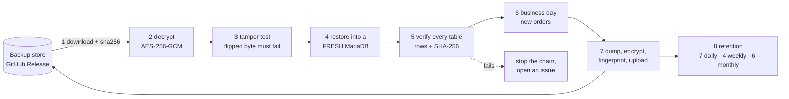

# LIFEBOAT

**Backups that are restored and verified every night.** Most backups are only tested on the day they are needed. LIFEBOAT restores its last backup into a fresh database every night, checks every table against a fingerprint taken at backup time, and only then takes the next backup. A broken backup therefore fails the next drill, not the next emergency.

[**Live status page + playground**](https://notdom1n1c.github.io/lifeboat/): the result of last night's drill, the backups in the store, and a playground where you can break a real SQLite database in your browser and bring it back.


Built by Dominic Aebersold (Informatiker EFZ Plattformentwicklung) as a portfolio project, next to [LAUNCHPAD](https://github.com/NotDom1n1c/launchpad). It runs on GitHub's free infrastructure and costs 0 CHF.

## The nightly drill



Every night at 02:23 UTC a GitHub Actions runner starts an empty MariaDB 11.8 container and runs `python -m lifeboat drill`:

| Step | What it proves |
|---|---|
| Download + SHA-256 check | the file is exactly what was uploaded |
| Decrypt (AES-256-GCM, 1 MiB chunks) | every chunk is authentic; reordered or truncated files are rejected too |
| Tamper test | a copy with one flipped byte **must** be rejected, or the run fails |
| Restore into an empty database | the backup is complete on its own; the time taken is the real **RTO** |
| Verify every table | row count and SHA-256 of all rows (in key order) match the manifest written at backup time |
| Business day | the shop gets new customers and orders, so every backup is different |
| Backup | `mariadb-dump --single-transaction` (consistent without locking), gzip, encrypt, fingerprint |
| Retention | grandfather-father-son: newest of the last 7 days, 4 weeks, 6 months |

If any of steps 1-5 fails, **no new backup is taken** from a database that did not restore correctly, the run fails, and an issue labelled `drill-failed` is opened. The next successful run closes it again.

The data is a small online shop (customers, products, orders, order items, a view) that started with two weeks of history and grows every night.

## Design decisions

- **The restore is the test.** Each night continues from the restored data. If restores stopped working, the chain would break at once.
- **Fingerprints, not file sizes.** A backup can have the right size and still be wrong. Each table's rows are hashed in primary-key order, so a single changed value is noticed, independent of how the server stores it.
- **Authenticated encryption.** AES-256-GCM per chunk, with the chunk index and a "last chunk" flag in the authenticated data. Bit rot, tampering, a wrong key and a cut-off upload are all detected before anything touches the database.
- **Off-site and free.** Backups are assets of a GitHub Release, not on the machine that made them. Manifests (sizes, row counts, checksums) are public on purpose; the data itself is only stored encrypted.
- **The key never touches the repo.** `LIFEBOAT_KEY` is a GitHub Actions secret.
- **Alerting.** A failed drill opens a GitHub issue; recovery closes it with a link to the run.
- **Tested without a database.** Unit tests cover the crypto (roundtrip, flipped byte, truncation, wrong key), the retention policy and the whole drill against a fake database, including a corrupted backup and a restore that silently loses a row.

## Use it

```bash
pip install -r requirements.txt
python -m lifeboat keygen                      # new LIFEBOAT_KEY
export LIFEBOAT_KEY=...                        # 32 random bytes, base64
export LIFEBOAT_STORE=local:./backups          # or github:OWNER/REPO
export LIFEBOAT_DB_EXEC="docker exec -i -e MYSQL_PWD=secret my-mariadb"
python -m lifeboat drill                       # restore + verify last backup, then back up
python -m lifeboat list                        # backups and why they are kept
python -m lifeboat restore [ID]                # restore + verify a specific backup
python -m lifeboat check FILE.enc              # is this file intact and the key right?
python -m unittest discover -s tests -v
```

## Layout

```
lifeboat/crypto.py     streaming AES-256-GCM, tamper and truncation detection
lifeboat/db.py         mariadb / mariadb-dump through any exec prefix, table fingerprints
lifeboat/drill.py      the nightly run, history and backup catalog
lifeboat/retention.py  grandfather-father-son policy
lifeboat/store.py      GitHub Release store and local folder store
lifeboat/shop.py       the shop database and its daily traffic
site/                  status page + SQLite playground (GitHub Pages)
.github/workflows/     ci, nightly drill, pages
```

## License

MIT
